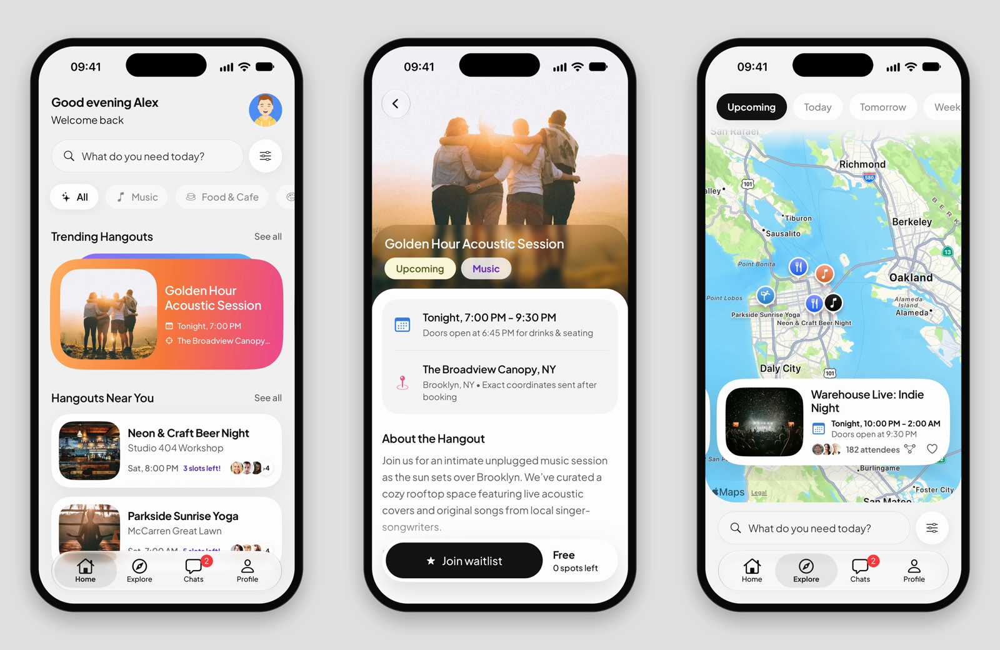
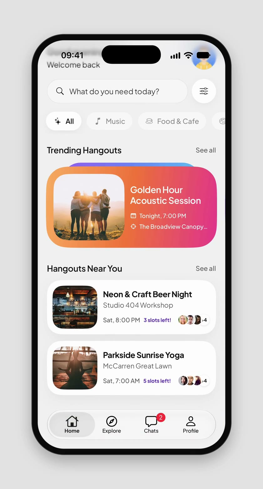
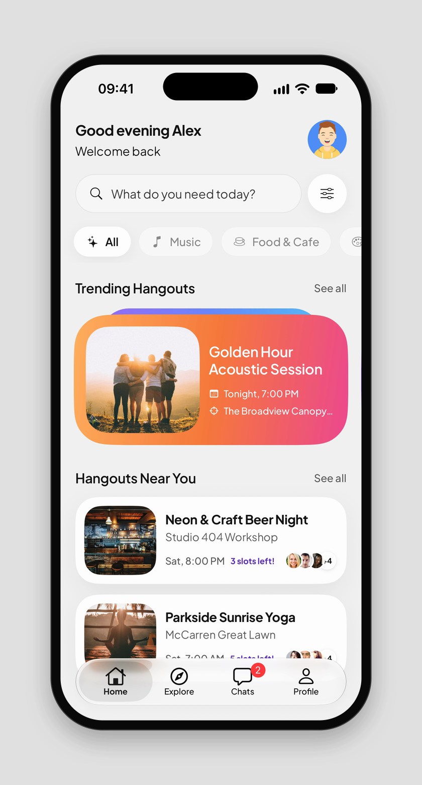
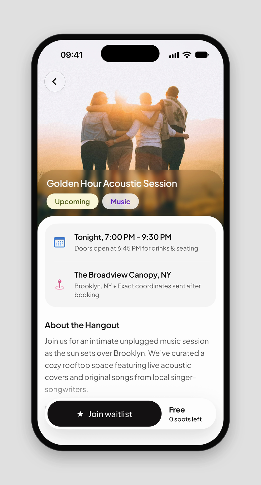
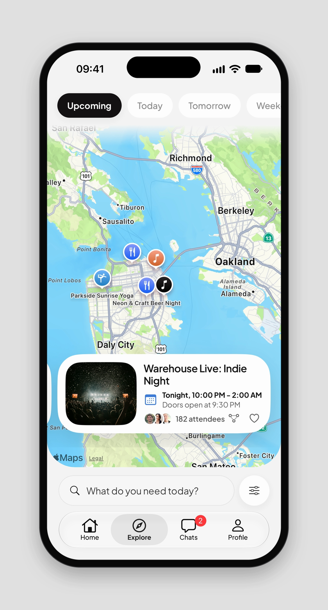
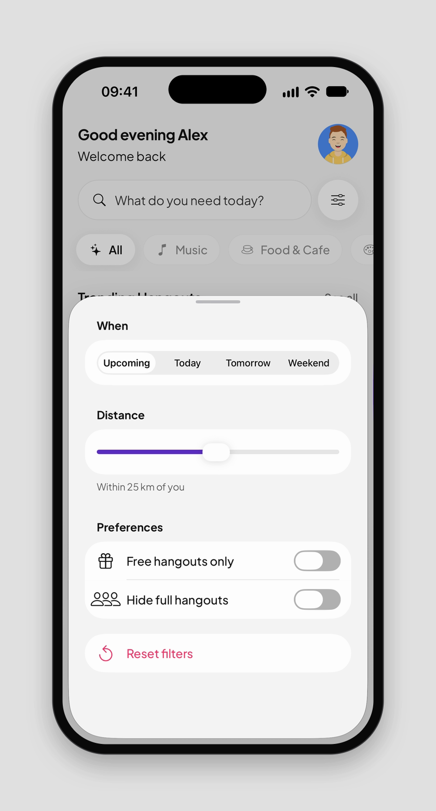
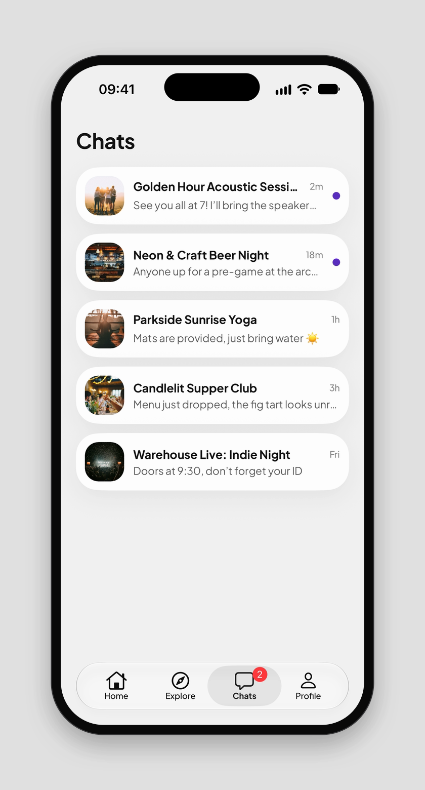
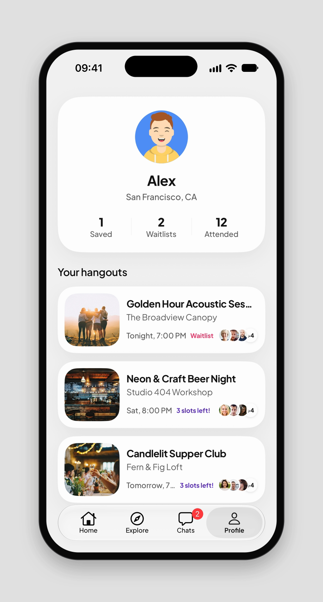

# Hangouts

A native rebuild of a hangouts discovery app, made with Expo. You can browse trending and nearby hangouts, see them on a map, filter them in a native sheet, and join one or its waitlist.



## Design credit

The design is by **Jennie** ([@jenidesignns](https://x.com/jenidesignns)). I found it in [her post on X](https://x.com/jenidesignns/status/2116071025913770119) and rebuilt it screen by screen to match the mocks as closely as I could. The visual design is hers. The code is mine.

## Demo

[](docs/media/demo.mp4)

The walkthrough was recorded on the iOS Simulator and covers Home, a hangout, Explore and filters, Chats, and Profile. Click the image to play it.

| Home | Hangout | Explore |
| --- | --- | --- |
|  |  |  |

| Filters | Chats | Profile |
| --- | --- | --- |
|  |  |  |

## Features

- **Home**: a time-of-day greeting, search, category chips, a trending carousel with stacked gradient cards and a subtle parallax, and a list of hangouts near you.
- **Hangout detail**: a full-bleed hero with a glass back button and a white sheet that overlaps it. Under that are the date and venue, the description, and a floating bar to book or join the waitlist. Opening a hangout uses the Apple zoom transition.
- **Explore**: Apple Maps on iOS and Google Maps on Android, with points of interest hidden, category pins, date pills and a swipeable card carousel kept in sync with the map.
- **Filters**: a SwiftUI sheet built with Expo UI, styled with the app's colours and typeface.
- **Chats**: one thread per hangout, with unread dots, opening straight into that hangout.
- **Profile**: saved, waitlist and attended counts, plus the hangouts you've saved or joined.
- Native tabs with Liquid Glass on iOS 26, haptics on key actions, and motion kept short and subtle that respects Reduce Motion.

## Tech

- Expo SDK 58 and React Native 0.88
- Expo Router with native tabs and `Link.AppleZoom`
- Expo UI (SwiftUI): `BottomSheet`, `Form`, `Picker`, `Slider` and `Toggle`
- Expo Maps, Expo Image, Expo Glass Effect, Expo Blur and Expo Haptics
- Reanimated 4 and Gesture Handler
- Plus Jakarta Sans, used in both React Native and SwiftUI views
- TypeScript

## Run it

The app uses native modules (Expo UI, Expo Maps and Liquid Glass), so it needs a development build. It won't run in Expo Go.

```bash
npm install
```

```bash
npx expo run:ios
```

Android maps need a Google Maps API key in `android.config.googleMaps.apiKey` in `app.json`. Then run:

```bash
npx expo run:android
```

After the first build, `npx expo start` is enough to keep iterating.

## Structure

- `src/app`: routes. `(tabs)` holds Home, Explore, Chats and Profile, and `hangout/[id]` is the detail screen.
- `src/components`: UI grouped by screen (`home`, `explore`, `hangout`, `chats`) plus shared `ui` pieces. `*.ios.tsx` files use Expo UI SwiftUI views, with a React Native fallback next to each one.
- `src/hooks`: scroll and data hooks.
- `src/data`: sample hangouts and filtering.
- `src/store`: saved, waitlist and filter state.
- `src/theme`: colours, gradients, type, spacing, shadows and motion tokens.
